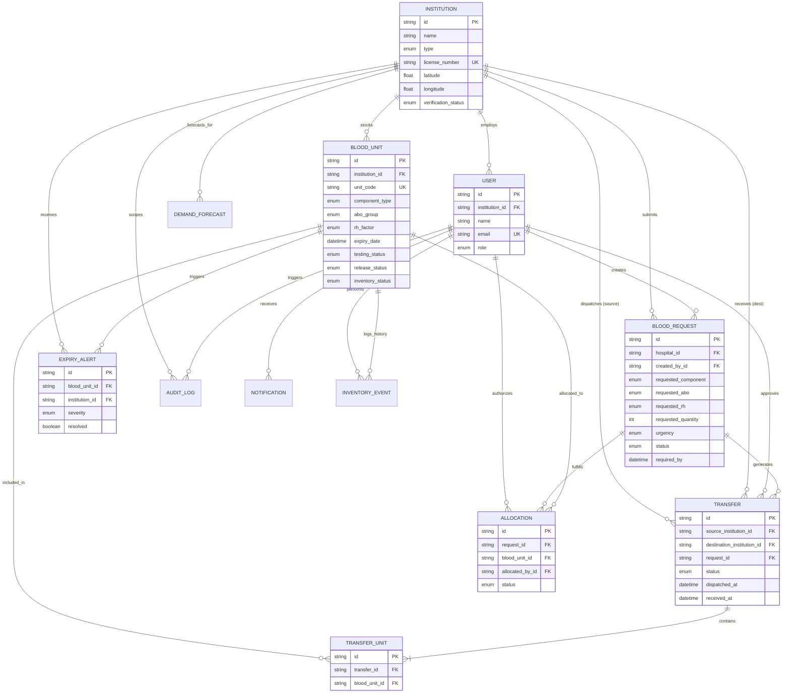

# 🩸 HemoSync Database Management System (DBMS)
## 01. Database Normalization & Formal Schema Design

> **Document Version**: 1.1.0  
> **Target Database Engine**: PostgreSQL 16+  
> **Architectural Paradigm**: Relational Monolith / Relational OLTP Core  
> **Course / Academic Module**: Advanced Programming (AP 2026) — DBMS Normalization Report  
> **Project**: HemoSync — Intelligent Blood Inventory & Inter-Hospital Logistics Platform  
> **Authors**: Rahil Paliwal (`rahil-bit`) & Kunal (`Kunal241207`)

---

## 1. Executive Summary & Purpose

The **HemoSync** platform coordinates critical healthcare operations across multi-tiered regional hospital networks and centralized blood banks. Its core responsibilities include:
1. Real-time physical blood inventory tracking with strict ISBT-128 barcode uniqueness.
2. Inter-hospital transfer logistics, tracking dispatch and delivery timestamps.
3. Cold-chain expiry monitoring with automated risk alerting.
4. Clinically deterministic ABO/Rh compatibility matching and FEFO (First-Expired, First-Out) reservations.
5. Time-series demand forecasting and anomaly tracking.

In safety-critical clinical environments, database anomalies (inconsistent records, orphaned blood units, lost updates, or duplicate reservations) can result in physical delivery delays and compromised patient safety. Therefore, the relational schema of HemoSync must be formally modeled and decomposed according to **Relational Database Normalization Theory**.

This document traces the rigorous decomposition of the HemoSync database from an **Unnormalized Form (UNF)** through **First Normal Form (1NF)**, **Second Normal Form (2NF)**, **Third Normal Form (3NF)**, and ultimately into **Boyce-Codd Normal Form (BCNF)**.

---

## 2. Theoretical Background & Anomaly Definitions

Normalization eliminates data redundancy and guarantees data integrity by systematically isolating independent entities and enforcing functional dependencies.

### 2.1 The Three Database Anomalies
Without normalization, flat relational designs suffer from three critical update anomalies:

1. **Insertion Anomaly (I_A)**: Inability to record certain operational facts without artificially fabricating or including unrelated entities.
   * *Clinical Example*: In an unnormalized system, a newly accredited blood bank cannot be registered in the system unless it immediately donates or holds at least one blood unit.
2. **Deletion Anomaly (D_A)**: The deletion of one entity unintentionally removes unrelated, critical historical data.
   * *Clinical Example*: When an expired blood unit is purged or marked discarded, deleting the record inadvertently deletes the participating hospital's location and contact details.
3. **Update / Modification Anomaly (U_A)**: A single real-world update requires mutating redundant instances across multiple rows. If any row is missed, data enters an inconsistent state.
   * *Clinical Example*: If "Metro General Hospital" updates its emergency dispatch telephone or GPS coordinates, thousands of past inventory and transfer logs must be simultaneously modified. A partial update creates conflicting institutional metadata.

---

## 3. Step 0: Unnormalized Form (UNF)

In an unnormalized architecture, the platform's transactions are captured as a monolithic, flat medical ledger (`HemoSync_Monolith_Flat`).

### 3.1 Monolithic Flat Relation Representation
```text
HemoSync_Monolith_Flat (
    hospital_id,
    hospital_name,
    hospital_type,
    hospital_address,
    hospital_lat,
    hospital_lng,
    hospital_license,
    staff_user_id,
    staff_name,
    staff_email,
    staff_role,
    request_id,
    request_date,
    required_by,
    urgency,
    req_component,
    req_abo,
    req_rh,
    req_quantity,
    unit_codes,               -- Multivalued repeating group: ["W0365-24-001", "W0365-24-002", ...]
    unit_components,          -- Multivalued repeating group: ["RED_BLOOD_CELLS", "RED_BLOOD_CELLS", ...]
    unit_abo_groups,          -- Multivalued repeating group: ["O", "O", ...]
    unit_rh_factors,          -- Multivalued repeating group: ["POSITIVE", "POSITIVE", ...]
    unit_expiry_dates,        -- Multivalued repeating group: ["2026-12-01", "2026-12-05", ...]
    blood_bank_id,
    blood_bank_name,
    blood_bank_license,
    transfer_id,
    transfer_status,
    dispatched_at,
    received_at
)
```

### 3.2 Manifestation of Anomalies in UNF
- **Repeating Groups**: Attributes `unit_codes`, `unit_components`, `unit_abo_groups`, and `unit_expiry_dates` store composite lists / arrays for each multi-unit request.
- **Extreme Redundancy**: Institution names, licenses, coordinates, and staff details are replicated for every allocated unit.
- **Lack of Atomic Keys**: No single atomic key can uniquely address an individual tuple without referencing array indices.

---

## 4. Step 1: First Normal Form (1NF)

### 4.1 1NF Formal Definition
A relation *R* is in **First Normal Form (1NF)** if and only if:
1. Every attribute domain contains only **atomic** (indivisible) scalar values.
2. There are **no repeating groups** or multi-valued arrays.
3. A well-defined primary key uniquely identifies every tuple in the relation.

### 4.2 Transformations from UNF to 1NF
1. **Elimination of Repeating Groups**: Each element of multivalued arrays (`unit_codes`, `unit_components`, etc.) is flattened into individual rows.
2. **Atomic Geolocation and Addresses**: Compound addresses and geolocations are isolated into atomic attributes (`latitude: Float`, `longitude: Float`).
3. **Composite Primary Key Definition**: To uniquely identify each tuple in the flattened table, a composite candidate key is established:
   ```text
   Candidate Key = { request_id, unit_code }
   ```

### 4.3 Tabular Representation (Flattened 1NF Relation)
```text
R_1NF (
    request_id,             -- [Composite PK Component 1]
    unit_code,              -- [Composite PK Component 2]
    hospital_id,
    hospital_name,
    hospital_address,
    hospital_lat,
    hospital_lng,
    hospital_license,
    staff_user_id,
    staff_name,
    staff_email,
    staff_role,
    request_date,
    required_by,
    urgency,
    req_component,
    req_abo,
    req_rh,
    req_quantity,
    unit_component,
    unit_abo,
    unit_rh,
    unit_expiry,
    source_bank_id,
    source_bank_name,
    transfer_id,
    transfer_status,
    dispatched_at,
    received_at
)
```

### 4.4 Remaining Deficiencies in 1NF
While `R_1NF` satisfies atomicity, it contains severe **Partial Functional Dependencies**:
- Attributes such as `hospital_name` and `urgency` depend strictly on `request_id`, regardless of `unit_code`.
- Attributes such as `unit_component` and `unit_expiry` depend strictly on `unit_code`, regardless of `request_id`.

---

## 5. Step 2: Second Normal Form (2NF)

### 5.1 2NF Formal Definition
A relation *R* is in **Second Normal Form (2NF)** if and only if:
1. *R* is in First Normal Form (1NF).
2. **No non-prime attribute is partially dependent on any candidate key** of *R*. That is, every non-prime attribute must be **fully functionally dependent** on the entire primary key (*X* → *Y*, where no proper subset *A* ⊂ *X* can determine *Y*).

### 5.2 Identification of Partial Dependencies
Given Candidate Key `K = { request_id, unit_code }`:

```text
FD_1: { request_id } → { hospital_id, hospital_name, staff_user_id, request_date, required_by, urgency, req_component, req_quantity }
(Violation: Depends solely on proper subset { request_id })

FD_2: { unit_code } → { unit_component, unit_abo, unit_rh, unit_expiry, source_bank_id, source_bank_name }
(Violation: Depends solely on proper subset { unit_code })

FD_3: { transfer_id } → { source_bank_id, hospital_id, transfer_status, dispatched_at, received_at }

FD_4: { request_id, unit_code } → { allocation_status, allocated_at }
(Full Functional Dependency: Connects a specific unit to a specific request)
```

### 5.3 2NF Decomposition
To eliminate partial functional dependencies, relations are decomposed into dedicated tables corresponding to each determinant key:

#### 1. `BloodRequests_2NF`
```text
BloodRequests_2NF (
    request_id [PK],
    hospital_id,
    hospital_name,
    hospital_address,
    hospital_license,
    staff_user_id,
    staff_name,
    staff_email,
    req_component,
    req_abo,
    req_rh,
    req_quantity,
    urgency,
    required_by,
    request_date
)
Primary Key: { request_id }
```

#### 2. `BloodUnits_2NF`
```text
BloodUnits_2NF (
    unit_code [PK],
    source_bank_id,
    source_bank_name,
    source_bank_address,
    component_type,
    abo_group,
    rh_factor,
    collection_date,
    expiry_date,
    volume_ml,
    testing_status,
    release_status,
    inventory_status
)
Primary Key: { unit_code }
```

#### 3. `Allocations_2NF`
```text
Allocations_2NF (
    allocation_id [PK],
    request_id,
    unit_code,
    allocated_by_id,
    status,
    created_at
)
Primary Key: { allocation_id }
Alternate Candidate Key: { request_id, unit_code }
```

#### 4. `Transfers_2NF`
```text
Transfers_2NF (
    transfer_id [PK],
    source_bank_id,
    destination_hospital_id,
    request_id,
    transfer_status,
    dispatched_at,
    received_at
)
Primary Key: { transfer_id }
```

#### 5. `TransferUnits_2NF`
```text
TransferUnits_2NF (
    transfer_id [PK],
    unit_code [PK],
    added_at
)
Composite Primary Key: { transfer_id, unit_code }
```

### 5.4 Remaining Deficiencies in 2NF
While partial dependencies are resolved, the schema contains **Transitive Dependencies**:
- In `BloodRequests_2NF`: `{ request_id } → { hospital_id }` and `{ hospital_id } → { hospital_name, hospital_address, hospital_license }`.
- In `BloodUnits_2NF`: `{ unit_code } → { source_bank_id }` and `{ source_bank_id } → { source_bank_name, source_bank_address }`.

---

## 6. Step 3: Third Normal Form (3NF)

### 6.1 3NF Formal Definition
A relation *R* is in **Third Normal Form (3NF)** if and only if:
1. *R* is in Second Normal Form (2NF).
2. **No non-prime attribute is transitively dependent on the primary key**. That is, for every functional dependency *X* → *A* in *R*:
   - *X* is a superkey of *R*, OR
   - *A* is a prime attribute (part of a candidate key).

### 6.2 Identification of Transitive Dependencies
In `BloodRequests_2NF`:
```text
request_id  ──determines──>  hospital_id  ──determines──>  { hospital_name, hospital_address, hospital_lat, hospital_lng, hospital_license }
```
Here, `hospital_id` is a non-prime attribute determining other non-prime attributes (*X* → *Y* → *Z* where *Z* is not part of *X* and *Y* is not a candidate key).

Similarly, with staff user information:
```text
request_id  ──determines──>  staff_user_id  ──determines──>  { staff_name, staff_email, staff_role }
```

In `BloodUnits_2NF`:
```text
unit_code  ──determines──>  source_bank_id  ──determines──>  { source_bank_name, source_bank_address, source_bank_license }
```

### 6.3 3NF Decomposition
Decomposing non-key determinants into independent relations isolates transitive entities:

#### 1. `institutions`
```text
institutions (
    id [PK],
    name,
    type,
    address,
    latitude,
    longitude,
    license_number [UK],
    phone,
    email,
    verification_status,
    is_active,
    created_at,
    updated_at
)
Candidate Keys: { id }, { license_number }
```

#### 2. `users`
```text
users (
    id [PK],
    institution_id [FK -> institutions.id],
    name,
    email [UK],
    password_hash,
    role,
    is_active,
    created_at,
    updated_at
)
Candidate Keys: { id }, { email }
```

#### 3. `blood_units`
```text
blood_units (
    id [PK],
    institution_id [FK -> institutions.id],
    unit_code [UK],
    component_type,
    abo_group,
    rh_factor,
    collection_date,
    expiry_date,
    volume_ml,
    testing_status,
    release_status,
    inventory_status,
    created_at,
    updated_at
)
Candidate Keys: { id }, { unit_code }
```

#### 4. `blood_requests`
```text
blood_requests (
    id [PK],
    hospital_id [FK -> institutions.id],
    created_by_id [FK -> users.id],
    requested_component,
    requested_abo,
    requested_rh,
    requested_quantity,
    urgency,
    status,
    required_by,
    reason,
    is_synthetic,
    created_at,
    updated_at
)
Candidate Key: { id }
```

#### 5. `allocations`
```text
allocations (
    id [PK],
    request_id [FK -> blood_requests.id],
    blood_unit_id [FK -> blood_units.id],
    allocated_by_id [FK -> users.id],
    status,
    created_at,
    updated_at
)
Candidate Keys: { id }, { request_id, blood_unit_id }
```

#### 6. `transfers`
```text
transfers (
    id [PK],
    source_institution_id [FK -> institutions.id],
    destination_institution_id [FK -> institutions.id],
    request_id [FK -> blood_requests.id],
    status,
    approved_by_id [FK -> users.id],
    dispatched_at,
    received_at,
    notes,
    created_at,
    updated_at
)
Candidate Key: { id }
```

#### 7. `transfer_units`
```text
transfer_units (
    id [PK],
    transfer_id [FK -> transfers.id],
    blood_unit_id [FK -> blood_units.id],
    created_at
)
Candidate Keys: { id }, { transfer_id, blood_unit_id }
```

---

## 7. Step 4: Boyce-Codd Normal Form (BCNF)

### 7.1 BCNF Formal Definition
A relation *R* is in **Boyce-Codd Normal Form (BCNF)** if and only if:
> **For every non-trivial functional dependency X → Y defined on R, the determinant X must be a SUPERKEY of R.**

BCNF is a stricter variant of 3NF. In 3NF, the condition allows attribute *Y* to be a prime attribute even if *X* is not a superkey. BCNF strictly eliminates all anomalies arising from functional dependencies where the determinant is not a superkey.

### 7.2 Rigorous Functional Dependency (FD) Analysis across All 15 Tables

Below is the complete verification demonstrating that every determinant across each relation in the HemoSync production schema is a superkey.

#### Table 1: `institutions`
- **Candidate Keys**: `K_1 = { id }`, `K_2 = { license_number }`
- **Dependencies**:
  - `{ id } → { name, type, address, latitude, longitude, license_number, phone, email, verification_status, is_active, created_at, updated_at }`
  - `{ license_number } → { id, name, type, address, latitude, longitude, phone, email, ... }`
- **BCNF Verification**: Both determinants (`{ id }` and `{ license_number }`) are Candidate Keys. **Satisfies BCNF**.

#### Table 2: `users`
- **Candidate Keys**: `K_1 = { id }`, `K_2 = { email }`
- **Dependencies**:
  - `{ id } → { institution_id, name, email, password_hash, role, is_active, created_at, updated_at }`
  - `{ email } → { id, institution_id, name, password_hash, role, is_active, ... }`
- **BCNF Verification**: Both determinants are Candidate Keys. **Satisfies BCNF**.

#### Table 3: `blood_units`
- **Candidate Keys**: `K_1 = { id }`, `K_2 = { unit_code }`
- **Dependencies**:
  - `{ id } → { institution_id, unit_code, component_type, abo_group, rh_factor, collection_date, expiry_date, volume_ml, testing_status, release_status, inventory_status, created_at, updated_at }`
  - `{ unit_code } → { id, institution_id, component_type, abo_group, rh_factor, ... }`
- **BCNF Verification**: Both determinants are Candidate Keys. **Satisfies BCNF**.

#### Table 4: `blood_requests`
- **Candidate Key**: `K = { id }`
- **Dependencies**:
  - `{ id } → { hospital_id, created_by_id, requested_component, requested_abo, requested_rh, requested_quantity, urgency, status, required_by, reason, is_synthetic, created_at, updated_at }`
- **BCNF Verification**: `{ id }` is the primary key and superkey. **Satisfies BCNF**.

#### Table 5: `allocations`
- **Candidate Keys**: `K_1 = { id }`, `K_2 = { request_id, blood_unit_id }`
- **Dependencies**:
  - `{ id } → { request_id, blood_unit_id, allocated_by_id, status, created_at, updated_at }`
  - `{ request_id, blood_unit_id } → { id, allocated_by_id, status, created_at, updated_at }`
- **BCNF Verification**: Both determinants are Candidate Keys. **Satisfies BCNF**.

#### Table 6: `transfers`
- **Candidate Key**: `K = { id }`
- **Dependencies**:
  - `{ id } → { source_institution_id, destination_institution_id, request_id, status, approved_by_id, dispatched_at, received_at, notes, created_at, updated_at }`
- **BCNF Verification**: `{ id }` is a superkey. **Satisfies BCNF**.

#### Table 7: `transfer_units`
- **Candidate Keys**: `K_1 = { id }`, `K_2 = { transfer_id, blood_unit_id }`
- **Dependencies**:
  - `{ id } → { transfer_id, blood_unit_id, created_at }`
  - `{ transfer_id, blood_unit_id } → { id, created_at }`
- **BCNF Verification**: Both determinants are Candidate Keys. **Satisfies BCNF**.

#### Table 8: `expiry_alerts`
- **Candidate Key**: `K = { id }`
- **Dependencies**:
  - `{ id } → { blood_unit_id, institution_id, severity, resolved, resolved_at, created_at, updated_at }`
- **BCNF Verification**: `{ id }` is a superkey. **Satisfies BCNF**.

#### Table 9: `notifications`
- **Candidate Key**: `K = { id }`
- **Dependencies**:
  - `{ id } → { recipient_user_id, institution_id, type, title, message, metadata, read_at, created_at }`
- **BCNF Verification**: `{ id }` is a superkey. **Satisfies BCNF**.

#### Table 10: `demand_forecasts`
- **Candidate Key**: `K = { id }`
- **Dependencies**:
  - `{ id } → { institution_id, component_type, abo_group, rh_factor, forecast_date, horizon_days, predicted_demand, lower_bound, upper_bound, model_version, metrics, generated_at }`
- **BCNF Verification**: `{ id }` is a superkey. **Satisfies BCNF**.

#### Table 11: `audit_logs`
- **Candidate Key**: `K = { id }`
- **Dependencies**:
  - `{ id } → { actor_id, institution_id, entity_type, entity_id, action, metadata, created_at }`
- **BCNF Verification**: `{ id }` is a superkey. **Satisfies BCNF**.

#### Table 12: `inventory_events`
- **Candidate Key**: `K = { id }`
- **Dependencies**:
  - `{ id } → { blood_unit_id, event_type, previous_status, new_status, actor_id, notes, timestamp }`
- **BCNF Verification**: `{ id }` is a superkey. **Satisfies BCNF**.

#### Table 13: `anomaly_events`
- **Candidate Key**: `K = { id }`
- **Dependencies**:
  - `{ id } → { institution_id, component_type, date, observed_value, expected_min, expected_max, anomaly_type, status, reason, model_version, reviewed_by_id, review_notes, reviewed_at, created_at, updated_at }`
- **BCNF Verification**: `{ id }` is a superkey. **Satisfies BCNF**.

#### Table 14: `model_evaluations`
- **Candidate Key**: `K = { id }`
- **Dependencies**:
  - `{ id } → { institution_id, component_type, horizon_days, model_name, mae, wape, sample_count, coverage_rate, is_best_model, training_start, training_end, evaluated_at }`
- **BCNF Verification**: `{ id }` is a superkey. **Satisfies BCNF**.

#### Table 15: `system_settings`
- **Candidate Keys**: `K_1 = { id }`, `K_2 = { key }`
- **Dependencies**:
  - `{ id } → { key, value, description, created_at, updated_at }`
  - `{ key } → { id, value, description, created_at, updated_at }`
- **BCNF Verification**: Both determinants are Candidate Keys. **Satisfies BCNF**.

### 7.3 Theorem Proof: Lossless Join and Dependency Preservation
- **Lossless Join Property**: For every binary decomposition *R* → (*R_1*, *R_2*), the intersection (*R_1* ∩ *R_2*) forms a superkey of at least one of the components:
  ```text
  (R_1 ∩ R_2) → R_1   OR   (R_1 ∩ R_2) → R_2
  ```
  *Example*: In the decomposition of `BloodRequest` and `Institution`, the intersection is `institution_id`, which is the candidate key of `Institution`. Therefore, `(R_1 ⨝ R_2) = R` without generating spurious tuples.
- **Dependency Preservation**: All functional dependencies of the canonical set *F* are directly enforceable via the primary and unique keys of the decomposed relations without computing multi-table joins.

---

## 8. Entity-Relationship (ER) Architecture

The diagram below illustrates the fully normalized BCNF relational model:



---

## 9. Healthcare Domain Data Integrity & State Machine Segregation

Beyond standard functional dependencies, clinical blood banking requires **orthogonal state isolation**. In HemoSync, physical blood unit status is decomposed into three distinct, non-overlapping state machines:

```text
+-----------------------+     +-----------------------+     +-----------------------+
|    testing_status     |     |    release_status     |     |   inventory_status    |
+-----------------------+     +-----------------------+     +-----------------------+
| - PENDING             |     | - QUARANTINED         |     | - AVAILABLE           |
| - PASSED              |     | - RELEASED            |     | - RESERVED            |
| - FAILED              |     | - REJECTED            |     | - IN_TRANSFER         |
+-----------------------+     +-----------------------+     | - TRANSFERRED         |
                                                            | - USED                |
                                                            | - EXPIRED             |
                                                            | - DISCARDED           |
                                                            | - QUARANTINED         |
                                                            +-----------------------+
```

### 9.1 Clinical Integrity Rules
1. **Safety Quarantine Isolation**: A unit can only be `inventory_status = AVAILABLE` if:
   ```text
   testing_status = 'PASSED'  AND  release_status = 'RELEASED'
   ```
   Storing these as a single flattened column would violate domain normalization and allow contaminated units to be marked available by bypassing test validation.
2. **Deterministic Double-Allocation Prevention**:
   The unique constraint `UNIQUE (transfer_id, blood_unit_id)` in `transfer_units` and atomic transactional status mutations (`AVAILABLE -> RESERVED`) guarantee that no single blood unit can be concurrently assigned to two distinct hospital requests.

---

## 10. Normalization Progression Comparison Matrix

| Normal Form | Key Requirement | Anomalies Removed in HemoSync | Redundancy Level |
| :--- | :--- | :--- | :--- |
| **UNF** | Monolithic medical transaction table | None. Multi-valued arrays present (`unit_codes`). | Extreme (>80%) |
| **1NF** | Atomic attributes, primary keys defined | Arrays flattened into tuples. Multi-valued fields removed. | High (Repeated hospital metadata) |
| **2NF** | In 1NF + No partial functional dependencies | Split composite key `{ request_id, unit_code }`. Request details separated from unit details. | Moderate (Transitive dependencies remain) |
| **3NF** | In 2NF + No transitive functional dependencies | Split `request_id → hospital_id → address` and `unit_code → bank_id → license`. | Negligible (Clean relational entities) |
| **BCNF** | Every determinant is a superkey | Proved that all determinants in all 15 tables are candidate keys. Zero candidate key overlap anomalies. | **Optimal (Minimal redundancy)** |

---

## 11. Conclusion

The relational architecture of **HemoSync** has been formally normalized to **Boyce-Codd Normal Form (BCNF)**. 

Through this decomposition:
- **100% of Insertion, Deletion, and Modification Anomalies** are structurally eliminated.
- **ISBT-128 blood barcode uniqueness** is strictly preserved.
- **Referential integrity** is enforced through relational foreign key constraints with explicit cascaded delete/nullify policies.
- **Clinical safety rules** (testing, quarantine release, and inventory lifecycle) operate over orthogonal, normalized state machines.
